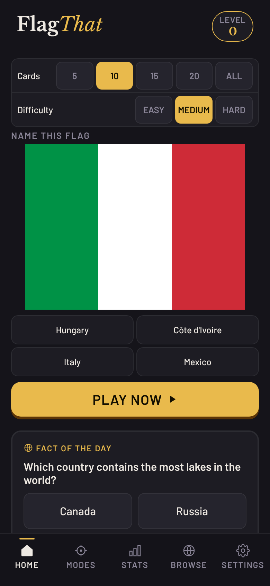
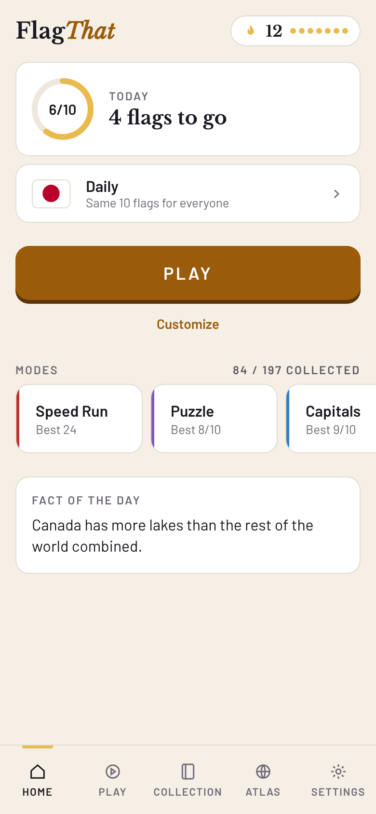
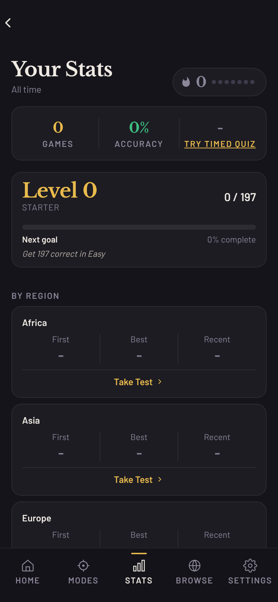
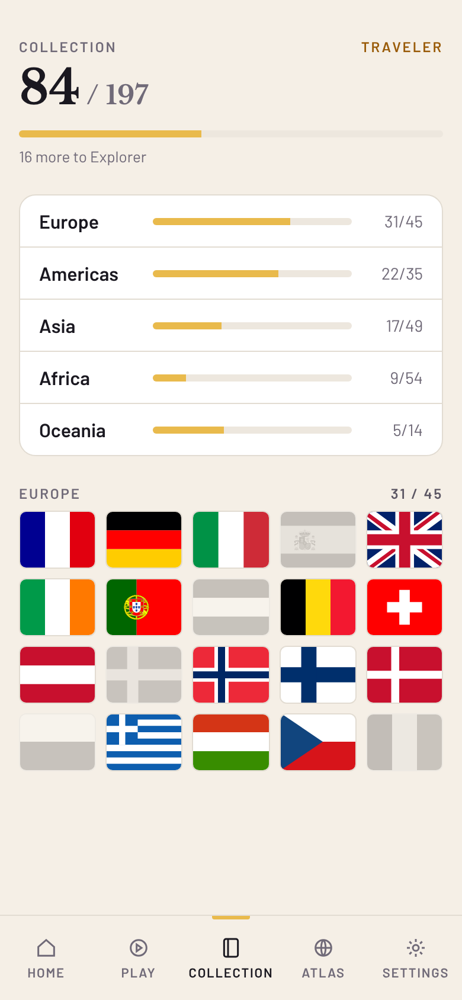
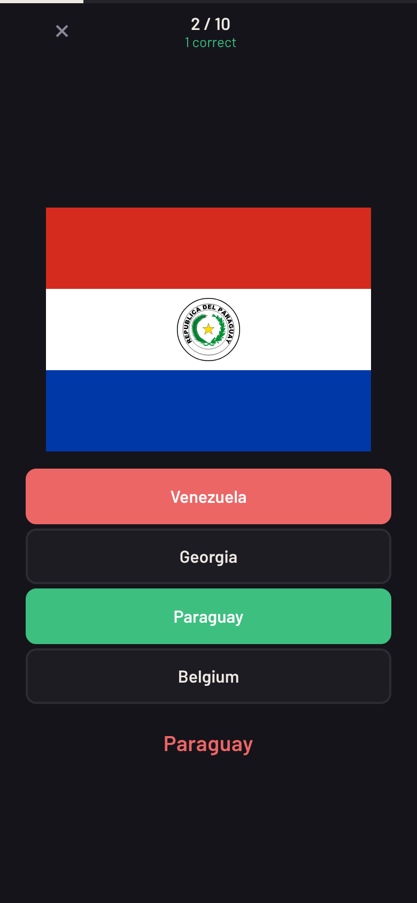
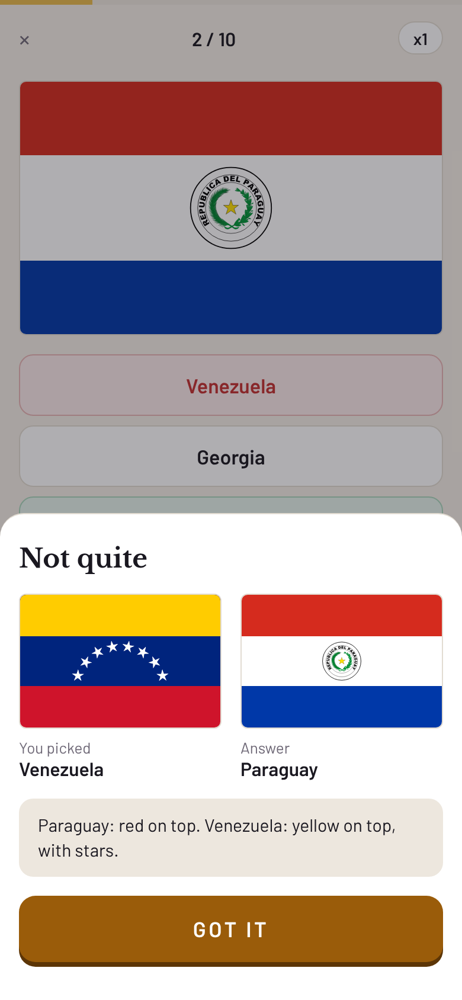
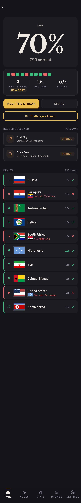
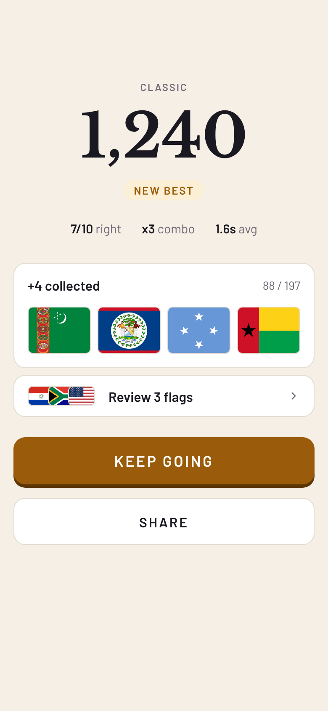

# Flag That: Design Audit

October 2026

The look is strong: the serif wordmark, warm paper, gold buttons. The problem is too much at once, and too little reason to come back.

Three fixes matter most:

1. **Progress you can feel.** One collection, not five systems.
2. **A round that teaches.** Show why you missed.
3. **A clean first screen.** One clear next step.

Plus: **clean it up.** Same spacing, same borders, fewer words.

| Now | Proposed |
|-----|----------|
|  |  |

---

## 1. Progress you can feel

### What's wrong

- **Level 1 is out of reach.** It needs 197 right answers in Easy. New players start on Medium, which doesn't count. Most players stay at "Level 0".
- **Five systems compete.** Levels, skill level, 25 badges, mastered flags, region tests. None of them leads.
- **The streak is hidden.** It only shows on Stats, not Home.
- **Reminders are off.** They default to off and live in Settings. The app never asks.
- **The Daily changes shape every day.** Easy one day, near impossible the next (typing country names from map outlines).

### The fix: a collection

- Every country starts empty. Get it right 3 times in a row and it's **collected**.
- Miss a collected flag later and it's marked **review**. It comes back soon. Nothing is lost.
- One number everywhere: **84 / 197**.
- Every mode counts.
- Ranks come fast at first: Tourist (0), Backpacker (10), Traveler (30), Explorer (60), Navigator (100), Diplomat (150), Cartographer (197).
- Home shows the streak and a daily goal of 10 flags. A 7-day streak earns one streak freeze (max 2).
- The Daily keeps one shape: 10 flags, 4 choices. Harder as the week goes on.
- Ask about reminders after the first good round.

| Now | Proposed |
|-----|----------|
|  |  |

### How to build it

1. Add `collectedAt` to each flag's stats. Set it once, never clear it. Today's data can't tell "collected, then missed" from "never collected".
2. Backfill: if `rightStreak >= 3`, set `collectedAt`.
3. New `src/utils/collection.ts` for state, counts and ranks. Unit test it.
4. New `StreakPill` and `GoalRing` components.
5. Stats tab becomes Collection.
6. Remove `levels.ts`, skill levels and their strings.
7. Daily: a fixed weekly schedule in `gameEngine.ts`.

---

## 2. A round that teaches

### What's wrong

- **Misses don't teach.** The answer flashes for 1.2 seconds, then the game moves on. Results shows your pick next to the answer (#142), but only after the round.
- **The wrong-answer label is red.** After a miss, the right answer shows in red. Red reads as "wrong".
- **Wrong options are random.** Only 81 flags have look-alikes listed. The rest get random countries, so you can guess without knowing.
- **Scores are flat.** Just a percentage. No points, no combo, no personal best.
- **Difficulty is manual.** Auto-promotion needs 10 perfect games in a row. It almost never happens.

| Now | Proposed |
|-----|----------|
|  |  |

### The fix

- **Learn card on every miss.** Both flags side by side. One line on how to tell them apart. One button: "Got it". Skipped in Speed Run. Can be turned off in Settings.
- **Smarter wrong options.** Add flag traits (colors, layout, emblem). Easy picks from other regions. Medium picks from the same region. Hard picks look-alikes.
- **Points and combos.** 100 per right answer, a speed bonus, and a combo multiplier. Show "New best".
- **Difficulty adjusts during the round.** Up after 3 right, down after 2 misses. Manual difficulty moves to Customize. Daily and challenges stay fixed so scores compare fairly.

| Now | Proposed |
|-----|----------|
|  |  |

### How to build it

1. `src/data/flagTraits.ts` and `src/data/flagTells.ts`. Start tells with the 81 look-alikes.
2. `rankDistractors()` in `gameEngine.ts`, with tests.
3. `LearnCard` component, used by every quiz screen.
4. `src/utils/scoring.ts`. Add `bestScoreByMode` to stats.

---

## 3. A clean first screen

### What's wrong

- **First run asks too much.** Five choices. One starts a 54-flag test.
- **Home is crowded.** Two mini-quizzes, two settings rows, a long mode list, a progress card. The sample flag and Play start different games.
- **Names don't match.** "Capital Connection" on Home, "Capital Quiz" on Modes. "Practice" means two different things. Impostor isn't on Modes. Neighbors isn't on Home.
- **Dark mode is the default.** The brand is warm paper, but every new player starts on black.

### The fix

- **First run: no menu.** Five famous flags. Then "You collected 4 countries." Then Home.
- **Home:** streak, today's goal, Daily, one Play button, a row of modes, one fact. Settings move to Customize.
- **One name per thing:**

| Thing | Name |
|-------|------|
| Standard round | Classic |
| Timed | Speed Run |
| Puzzle | Puzzle |
| Capitals | Capitals |
| Neighbors | Neighbors |
| Impostor | Spot the Fake |
| Weak flags | Review |
| Browse | Atlas |
| Stats | Collection |

- **Every Results screen has "Keep going".**
- **Default to light mode,** or follow the phone's setting. Show the paper.
- **Keep the name.** "Flag That" is short, and you own the domain. Decide on the bundle ID (`com.flagsareus.app`) before the first App Store release. It can't change later.

### How to build it

1. Onboarding: go straight into a 5-flag `easy_flags` round.
2. One mode list in `src/utils/modes.ts`. Home, Modes and Results all read from it.
3. Rebuild Home from `TodayCard`, Play, `ModeShelf` and `FactOfDay`.
4. Split `ResultsScreen.tsx` (1,331 lines) into hero, review and actions.

---

## Clean it up

### Spacing and borders

The theme has tokens. Screens don't always use them.

- **4 border widths** in use: 1, 1.5, 2 and 3. Use 1 for cards and buttons. Use 3 only for accent bars.
- **92 hand-typed spacing values** (6, 13, 14, 18 and more) next to 408 that use tokens. Use only `spacing` tokens: 4, 8, 16, 24, 32, 48.
- **15 hand-typed corner radii.** Most are circles (radius = half the size). Use `borderRadius.full` for those.
- **One page margin: 16px.**
- **Even gaps:** 8 inside a group, 16 between items, 24 between sections.
- **Every flag gets the same 1px border and 6px corners.** White flags (Japan, Cyprus) need the border to show their edge.
- **The game screen** leaves a large empty band above the flag. Move the flag up.

The mockups follow these rules.

### Words

Fewer words. Plain words. Write like a person talks.

- Use "use", not "utilize". Use "start", not "begin". Use "help", not "assist".
- One idea per line. Cut "please", "really" and "totally".
- Buttons: one or two words. "Play", "Got it", "Keep going".

Rewrites from `en.ts`:

| Now | Proposed |
|-----|----------|
| Welcome to your flag knowledge | Name this flag |
| Flags, capitals, maps and geography. See how well you really know the world. | How many flags do you know? |
| Allow notifications in your device settings to enable daily reminders. | Turn on notifications in Settings to get reminders. |
| This will clear all stats, streaks, and progress. This cannot be undone. | This erases all progress. You can't undo it. |
| There are no countries with land borders in the selected category. | No countries with borders here. |
| This challenge code is not valid. Check that you pasted the full code. | That code doesn't work. Check you pasted all of it. |
| Flag That is free with no ads. Help keep it that way - watch a quick video. Totally optional. | Flag That is free. Watch a short video to help keep it that way. |
| Same 10 flags for everyone | (keep) |

Update all 6 languages together.

---

## Done

Shipped with this audit:

- Level 1 is now 25 right answers in any mode.
- Home shows the day streak instead of "Level 0" (`StreakPill`, shared with Stats).
- Learn card after a miss in the classic quiz, daily and practice (`LearnCard`). Off switch in Settings: "Tips on misses".
- The answer shown after a miss is green, not red.
- Wrong options: Easy picks other regions, Medium picks look-alikes, then the same region (`pickDistractors`, tested).
- Daily reminder offer, once, after a round of 70% or better (`ReminderPrompt`, phones only).
- Theme follows the phone, light if unknown.
- Borders: 1.5px is now 1px. Circles use `borderRadius.full`. Hand-typed spacing snapped to the token grid.
- Shorter copy in all 6 languages.
- Flags ship with the app (`assets/flags`), so the game works offline and never shows "Tap to retry" when the flag CDN is down.
- Keyboard on web: 1-4 pick an answer, Enter or Space continue.
- Light mode: gold text uses a darker gold (`goldText`) so it reads on cream.

Still to do: Collection, new Home, new first run, one mode list and names, points and combos, weekly Daily, Learn card in Puzzle and Capitals, measuring.

## Order

| Step | What |
|------|------|
| 0 | Decide how to measure (below) |
| 1 | Done (see above) |
| 2 | Collection, daily goal, streak freeze |
| 3 | New first run, new Home, one mode list, new names |
| 4 | Points and combos, weekly Daily, share card |

## Measuring

The iOS and Android apps send no analytics. The web build only counts page views. So we can't see if these changes work.

Pick one:

1. **Add simple, anonymous events** (round played, daily done, reminder on). Needs an App Store privacy update.
2. **Measure on web only,** plus App Store and Play Store retention numbers. Free and private, but rough.

## Smaller things

- The sample flag on Home doesn't count toward anything.
- The first Daily share asks for a name before sharing.
- `ResultsScreen.tsx` and `StatsScreen.tsx` are over 1,200 lines each. Split them first.
